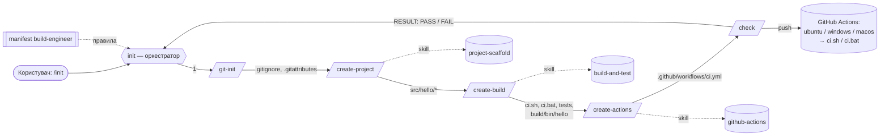

# Архітектура AI-агента build-engineer

## 1. Які проблеми вирішує агент
Без агента кожен однотипний проєкт (каркас, система збірки, тести, CI на трьох ОС)
створюється вручну або разовими запитами до AI. Результат тоді невідтворюваний,
кроки пропускаються, а помилки маскуються. Агент:
- формалізує вимоги варіанту 2 (Python + venv + pytest) у manifest із правилами й критеріями успіху;
- розбиває роботу на повторно використовувані skills і короткі ідемпотентні commands;
- виконує їх в оркестраторі в правильному порядку і **зупиняється на першій помилці**;
- доводить результат детермінованою перевіркою `/check`, а не словами «готово».

## 2. Відповідність структури методички та Claude Code
Методичка описує формат GitHub Copilot (`.github/agents`, `.github/prompts`, `.github/skills`).
У роботі використано Claude Code, тому файли лежать у стандартних для нього каталогах:

| Роль файлу              | Методичка (Copilot)                              | Цей репозиторій (Claude Code)          |
|-------------------------|--------------------------------------------------|----------------------------------------|
| Agent manifest          | `.github/agents/build-engineer.agent.md`         | `.claude/agents/build-engineer.md` (+ `CLAUDE.md` підключає його до кожної сесії) |
| Skill: створення проєкту | `.github/skills/project-scaffold/SKILL.md`      | `.claude/skills/project-scaffold/SKILL.md` |
| Skill: збірка і тести   | `.github/skills/build-and-test/SKILL.md`         | `.claude/skills/build-and-test/SKILL.md` |
| Skill: GitHub Actions   | `.github/skills/github-actions/SKILL.md`         | `.claude/skills/github-actions/SKILL.md` |
| Command `git-init`      | `.github/prompts/git-init.prompt.md`             | `.claude/commands/git-init.md` → `/git-init` |
| Command `create-project`| `.github/prompts/create-project.prompt.md`       | `.claude/commands/create-project.md` → `/create-project` |
| Command `create-build`  | `.github/prompts/create-build.prompt.md`         | `.claude/commands/create-build.md` → `/create-build` |
| Command `create-actions`| `.github/prompts/create-actions.prompt.md`       | `.claude/commands/create-actions.md` → `/create-actions` |
| Command `check`         | `.github/prompts/check.prompt.md`                | `.claude/commands/check.md` → `/check` (+ `.claude/scripts/check.py`) |
| Orchestrator `init`     | `.github/prompts/init.prompt.md`                 | `.claude/commands/init.md` → `/init` |
| CI workflow             | `.github/workflows/ci.yml`                       | `.github/workflows/ci.yml` (без змін)  |
| `CMakeLists.txt`        | система збірки C++                               | `pyproject.toml` + `requirements-dev.txt` + `ci.sh`/`ci.bat` (варіант 2) |

## 3. Компоненти

### Manifest (`.claude/agents/build-engineer.md`)
Роль, вхідні параметри, область відповідальності, список skills/commands, порядок роботи,
правила роботи з файлами (create / skip / ask — без перезапису), заборонені дії
(видалення, force-push, зміна історії, секрети, приховування помилок) і критерії завершення
(`/check` → `RESULT: PASS`).

### Skills
| Skill              | Вхід | Вихід | Перевірка |
|--------------------|------|-------|-----------|
| `project-scaffold` | `language=python`, `project_name=hello` | `src/hello/{__init__,core,__main__}.py`, `tests/`, `.gitignore`, розділ README | `python -m hello` → `Hello, World!` |
| `build-and-test`   | каркас `src/hello/` | `pyproject.toml`, `requirements-dev.txt`, `calc.py` (`add`), `tests/test_hello.py` (`test_BasicAddition`), `ci.*`, `run.*` | `ci.*` → `CI: SUCCESS`, `build/bin/hello` |
| `github-actions`   | `ci.sh`, `ci.bat` | `.github/workflows/ci.yml` | YAML, тригери, матриця 3 ОС, лише виклик скриптів |

Кожен skill містить шаблони файлів, порядок дій, приклад входу/результату та таблицю типових помилок.

### Commands
| Command           | Передумова | Дія | Змінює файли? |
|-------------------|-----------|-----|---------------|
| `/git-init`       | git | перевірка репозиторію, доповнення `.gitignore`/`.gitattributes`, `git status` | так (лише доповнення) |
| `/create-project` | `.gitignore` | skill `project-scaffold` | так |
| `/create-build`   | `src/hello/__main__.py` | skill `build-and-test` + локальна збірка | так |
| `/create-actions` | `ci.sh`, `ci.bat` | skill `github-actions` | так |
| `/check`          | Python | `check.py`: agent / structure / git / build / workflow | **ні** |
| `/init`           | feature-гілка | оркестрація 1→5 | через підкоманди |

## 4. Потік даних між етапами

| Етап | Отримує | Передає далі |
|------|---------|--------------|
| git-init | стан репозиторію | валідний репозиторій, `.gitignore` |
| create-project | `project_name`, `.gitignore` | пакет `src/hello` з точкою входу |
| create-build | `src/hello/__main__.py` | тести, скрипти `ci.*`, зібраний `build/bin/hello`, `junit.xml` |
| create-actions | `ci.sh`, `ci.bat` | `ci.yml`, що лише викликає скрипти |
| check | усі файли + результати збірки | `RESULT`, код виходу 0/1 |

## 5. Обробка помилок оркестратором
1. Кожна command має передумови. Якщо передумова не виконана, оркестратор зупиняється з
   `INIT FAILED at step N/5 (<command>): <message>`.
2. Ненульовий код виходу `ci.sh`/`ci.bat` (кожен крок у `ci.bat` має `|| goto :fail`, `ci.sh`
   виконується з `set -euo pipefail`) = помилка кроку. Наступні кроки не запускаються.
3. Конфлікт із наявним файлом (вміст відрізняється від шаблону) — не помилка, а **зупинка з
   запитом** до користувача. Файл не перезаписується.
4. Робота вважається успішною лише після `/check` → `RESULT: PASS`. `check.py` також перевіряє,
   що сам не змінив відстежувані файли (`git status --porcelain` до/після).
5. Виправлення робиться в інструкціях (skill/command), а не ручною правкою результату. Потім
   `/init` перезапускається: усі кроки ідемпотентні.
6. Помилки й рішення фіксуються в `docs/ai-log.md`.

## 6. Обмеження агента
- Підтримує лише варіант 2 (Python); інші мови відхиляються.
- Не виконує `git push`, не створює PR і не змінює налаштування GitHub без прохання користувача.
- Результат CI на GitHub агент не бачить напряму — його треба перевірити у вкладці Actions
  (або через `gh run list`).
- Якість результату залежить від моделі. Тому шаблони у skills зафіксовані, а перевірка
  виконується детермінованим скриптом.
